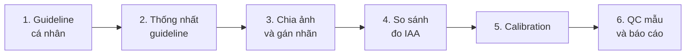

# Day 07 Lab — Nhóm Just2Men: 2A202603230 - Trần Tuấn Anh, 2A202603227 - Doãn Tùng Lâm

**Nhóm 2–5 người · 4 giờ · 40 ảnh đường phố châu Á · gán box bằng CVAT**

Bạn nhận một guideline gán nhãn **sơ sài** và 40 ảnh chứa nhiều tình huống mà nó không nói tới.
Việc của nhóm: **viết lại guideline cho đủ dùng**, chia việc, gán nhãn độc lập, đo độ đồng thuận, họp calibration,
rồi quyết định **Release / Hold / Rework** cho lô nhãn.

*Có gì lạ trong ảnh? Tuk-tuk, xe chở xe, tượng, xe giả tưởng, tượng pickup, ma-nơ-canh… Guideline của bạn phải xử lý được chúng.*

## Quy trình

Trọng tâm là **guideline**: nhãn chỉ tốt khi mọi người hiểu quy tắc giống nhau.

## Bắt đầu

1. **Fork** repo thành repo **public** của nhóm, mời các bạn làm collaborator, mỗi người `git clone`.
2. Đọc **[GUIDE.md](GUIDE.md)** (từng pha, lệnh chạy) và **[RULES.md](RULES.md)**.
3. `pip install -r requirements.txt` (Python 3.9+).

> **Khi nộp:** đổi dòng tiêu đề này thành `# Day 07 Lab — Nhóm <Tên>: <MSHV> - <Họ và tên>, …` cho đủ mọi thành viên. Xem [SUBMISSION.md](SUBMISSION.md).

## Tài liệu

| Bạn cần | Xem |
|---|---|
| Các pha làm việc và lệnh | [GUIDE.md](GUIDE.md) |
| Mốc tiến độ 4 giờ | [CHECKPOINTS.md](CHECKPOINTS.md) |
| Quy tắc làm bài | [RULES.md](RULES.md) |
| Chấm điểm (100 điểm) | [RUBRIC.md](RUBRIC.md) |
| Sản phẩm phải nộp, tên repo, checklist | [SUBMISSION.md](SUBMISSION.md) |
| Thông tin nhóm và kết quả tóm tắt | [TEAM.md](TEAM.md) |
| Cài và dùng CVAT | [docs/CVAT_SETUP.md](docs/CVAT_SETUP.md) |
| Công thức, ngưỡng, cây quyết định QC | [docs/QC_CHEATSHEET.md](docs/QC_CHEATSHEET.md) |
| Mẫu báo cáo QC, ghi chú cá nhân | [docs/QC_REPORT_TEMPLATE.md](docs/QC_REPORT_TEMPLATE.md), [docs/INDIVIDUAL_NOTE_TEMPLATE.md](docs/INDIVIDUAL_NOTE_TEMPLATE.md) |
| Các script | [scripts/README.md](scripts/README.md) |
| Guideline khởi đầu (v0), khung viết guideline | [guideline/](guideline/) |
| Nguồn và giấy phép ảnh | [data/README.md](data/README.md), [data/ATTRIBUTION.csv](data/ATTRIBUTION.csv) |
